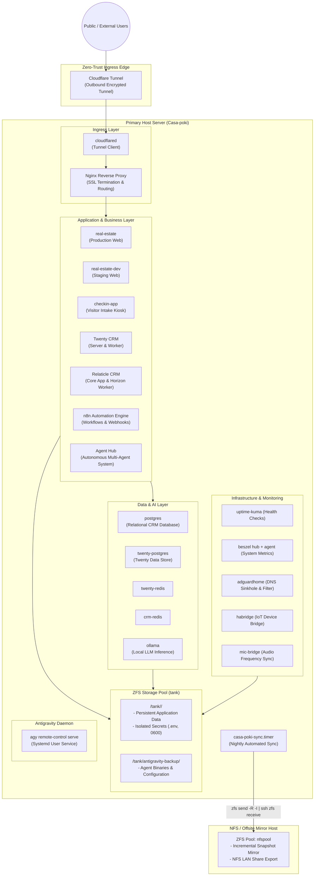

# Casa-poki Infrastructure & Service Architecture

Welcome to **Casa-poki**, a modular infrastructure and homelab architecture powering real estate applications, relationship management (CRM), workflow automations, local AI inference, networking, and home automation.

---

## Table of Contents
1. [System Architecture Overview](#1-system-architecture-overview)
2. [Storage & Secrets Architecture](#2-storage--secrets-architecture)
3. [Backup, Replication & Disaster Recovery](#3-backup-replication--disaster-recovery)
4. [Service Catalog & Deep Dives](#4-service-catalog--deep-dives)
   - [Reverse Proxy & Ingress (`nginx`, `cloudflared`)](#reverse-proxy--ingress)
   - [CRM Stack (`twenty`, `relaticle`, `postgres-db`)](#crm-stack)
   - [Automation & AI Stack (`ai/n8n`, `agents`, `ollama`)](#automation--ai-stack)
   - [Web Platforms (`real-estate`, `checkin`)](#web-platforms)
   - [Observability & Monitoring (`monitor`)](#observability--monitoring)
   - [Network & Home Infrastructure (`adguard`, `habridge`, `mic-bridge`)](#network--home-infrastructure)
   - [Antigravity AI Agent Engine](#antigravity-ai-agent-engine)
5. [Port Matrix & Routing](#5-port-matrix--routing)
6. [Bare-Metal Restore & Disaster Recovery Instructions](#6-bare-metal-restore--disaster-recovery-instructions)
7. [Operational & Security Guidelines](#7-operational--security-guidelines)

---

## 1. System Architecture Overview



---

## 2. Storage & Secrets Architecture

Casa-poki enforces total physical separation between application code, application runtime state, and secrets.

### ZFS Pool: `tank`
- **Mountpoint**: `/tank`
- **Volume Design**: Independent ZFS datasets for each application domain, providing snapshot isolation, compression, and snapshot rollbacks.
- **Datasets**:
  | Dataset | Purpose |
  | :--- | :--- |
  | `tank` | Root dataset (contains core volumes and backup archives) |
  | `tank/adguard` | AdGuard Home DNS configuration, query filters, and upstream records |
  | `tank/habridge` | HA-Bridge smart home virtual devices and configuration |
  | `tank/monitor` | Uptime Kuma and Beszel metric stores and monitoring history |
  | `tank/n8n` | n8n workflow execution database, custom nodes, and file storage |
  | `tank/npm` | Nginx reverse proxy configuration and automated SSL certificates |
  | `tank/ollama` | Local LLM weights and neural model configurations |
  | `tank/postgres-db` | PostgreSQL 17 relational database files |
  | `tank/re_office_data`| Office 365 synchronization state and cached tokens |
  | `tank/relaticle` | Relaticle CRM file storage, OAuth keys, and Redis state |

### Secrets Management & Hygiene
- **Zero Leak Policy**: No secret, password, private key, token, or `.env` file is ever committed to version control.
- **Location on Host**: All service credentials reside exclusively on `/tank/<service>/.env` with restricted `0600` permissions.
- **Repo Connection**: Services in the repository connect to their credentials via symlinks (`.env -> /tank/<service>/.env`).
- **Templates**: Every service repository includes a sanitized `.env.example` file documenting required configuration keys without sensitive values.

---

## 3. Backup, Replication & Disaster Recovery

Casa-poki relies on native, block-level ZFS replication to a dedicated secondary ZFS host for offsite disaster recovery.

### Replication Architecture
- **Secondary Host**: Network-attached ZFS pool (`nfspool`).
- **Protocol**: Encrypted SSH stream carrying native ZFS send/receive streams.
- **Failover NFS Export**: The secondary ZFS pool is exported with NFS read/write permissions for instant network mounting during hardware maintenance.

### Automated Incremental Synchronization
- **Schedule**: Nightly automated sync via systemd timer (`casa-poki-sync.timer`) at 02:00 AM.
- **Script**: `/usr/local/bin/casa-poki-sync.sh` (source-controlled in `scripts/casa-poki-sync.sh`).
- **Workflow**:
  1. Archives local Antigravity AI agent binaries and settings to `/tank/antigravity-backup/`.
  2. Resolves latest common snapshot between source (`tank`) and target (`nfspool`).
  3. Creates recursive local snapshot `tank@daily-<timestamp>`.
  4. Streams compressed incremental delta to the secondary host.
  5. Automatically prunes snapshots older than 14 days on both hosts to optimize storage.
  6. Writes execution logs to `/var/log/casa-poki-sync.log`.

---

## 4. Service Catalog & Deep Dives

### Reverse Proxy & Ingress
- **`nginx`** (`nginx/`):
  - High-performance reverse proxy for internal routing and SSL termination.
  - Configuration mounted read-only from `/tank/npm/conf.d`.
  - Let's Encrypt wildcard certificates automated via Certbot DNS challenge.
- **`cloudflared`** (`cloudflared/`):
  - Zero-Trust tunnel client establishing encrypted outbound tunnels to Cloudflare.
  - Exposes public services without exposing host firewall ports or requiring static public IPs.

### CRM Stack
- **`twenty`** (`twenty/`):
  - Modern CRM stack running application server, background queue worker, PostgreSQL, and Redis cache.
  - Handles client contacts, sales pipelines, and task schedules.
- **`relaticle`** (`relaticle/`):
  - Comprehensive relationship management platform running Laravel, Filament PHP, and Horizon Redis queue workers.
- **`postgres-db`** (`postgres-db/`):
  - Dedicated PostgreSQL 17 Alpine instance providing relational database services for CRM workloads.

### Automation & AI Stack
- **`ai/n8n`** (`ai/n8n/`):
  - Advanced node-based workflow automation engine connecting CRM instances, marketing platforms, and AI APIs.
- **`agents`** (`agents/`):
  - Autonomous Multi-Agent Hub featuring 7 specialist personas (Manager, IT, Auditor, Intake, Finance, Marketing, CMA).
  - Equipped with embedded `sqlite-vec` vector memory engine and FastEmbed (`BAAI/bge-small-en-v1.5`) for semantic knowledge retrieval, autonomous inter-agent delegation, and continuous learning.
- **`ollama`** (`ollama/`):
  - Local GPU/CPU neural network inference server hosting private language models for CRM categorization and extraction.

### Web Platforms
- **`real-estate`** (`real-estate/`):
  - High-speed responsive web platform built with React, Vite, Tailwind CSS, and route pre-rendering.
  - Staging (`real-estate-dev`) and production (`real-estate`) instances with strict dev-first promotion workflows.
- **`checkin`** (`checkin/`):
  - Interactive visitor registration kiosk app for open house visitor intake.

### Observability & Monitoring
- **`monitor`** (`monitor/`):
  - **Beszel Hub & Agent**: Resource monitoring framework providing real-time CPU, RAM, disk, and container metrics.
  - **Uptime Kuma**: Self-hosted uptime monitor providing heartbeat checks, response time metrics, and alert triggers.

### Network & Home Infrastructure
- **`adguard`** (`adguard/`):
  - Network-wide DNS sinkhole, tracker blocking, and local hostname resolution.
- **`habridge`** (`habridge/`):
  - Local IoT device emulator bridging smart home peripherals.
- **`mic-bridge`** (`mic-bridge/`):
  - Audio capture and FFT spectrum analysis bridge broadcasting lighting sync pulses via MQTT.

### Antigravity AI Agent Engine
- **Service**: `antigravity-cli-daemon.service` running as a systemd user daemon.
- **Linger Configuration**: Enabled (`loginctl enable-linger`) to persist agent availability across sessions.
- **Backup**: Binaries, user configuration, and plugin states are backed up inside `/tank/antigravity-backup/`.

---

## 5. Port Matrix & Routing

| Port | Service Container | Primary Role | Ingress Route |
| :--- | :--- | :--- | :--- |
| **80 / 443** | `nginx` | HTTP / HTTPS Ingress | Local LAN / Gateway |
| **3001** | `uptime-kuma` | Uptime Monitor UI | Cloudflare Tunnel / Status Subdomain |
| **3030 / 8053** | `adguardhome` | AdGuard Web Interface | Local LAN Only |
| **5432** | `postgres` | Relational Database | Internal Docker Network |
| **5678** | `n8n` | Workflow Automation | Cloudflare Tunnel / Automation Subdomain |
| **8085** | `twenty-server` | Twenty CRM Server | Cloudflare Tunnel / CRM Subdomain |
| **8088** | `real-estate` | Production Web Platform | Cloudflare Tunnel / Main Domain |
| **8089** | `real-estate-dev` | Staging Web Platform | Cloudflare Tunnel / Dev Subdomain |
| **8091** | `checkin-app` | Visitor Registration Kiosk | Cloudflare Tunnel / Checkin Subdomain |
| **8094** | `agent-hub` | Autonomous Multi-Agent API | Local LAN / Internal Docker Network |
| **8095** | `beszel` | System Metrics Hub | Cloudflare Tunnel / Metrics Subdomain |
| **9123** | `habridge` | Smart Home Bridge | Local LAN Only |
| **11434**| `ollama` | Local AI Inference | Local LAN / Internal Docker Network |
| **45876**| `beszel-agent` | Metric Collector Daemon | Host Internal Loopback |

---

## 6. Bare-Metal Restore & Disaster Recovery Instructions

In the event of hardware failure, the entire system can be rebuilt on a fresh Ubuntu LTS host using the automated recovery engine.

### Automated Recovery
Run the automated restore script as root:

```bash
curl -fsSL https://raw.githubusercontent.com/lokeshchanana/Casa-poki/main/scripts/restore-casa-poki.sh | sudo bash
```

Or execute directly from the cloned repository:

```bash
sudo ./scripts/restore-casa-poki.sh
```

### Recovery Automation Steps:
1. **Tooling & Runtimes**: Automatically installs `zfsutils-linux`, `docker.io`, `docker-compose-plugin`, `nfs-common`, `git`, and utilities.
2. **User Configuration**: Configures the primary system user with appropriate group permissions for Docker and administration.
3. **Storage Pool Recovery**:
   - Re-imports existing physical pool (`tank`), OR
   - Recreates pool and streams latest snapshots from the backup server, OR
   - Mounts the backup pool directly over NFS for instant recovery.
4. **Secrets & Symlinks**: Automatically reconnects `/tank/<service>/.env` secrets to their respective service directories.
5. **Docker Infrastructure**: Rebuilds necessary external bridge networks (`postgres-network`, `relaticle-internal`).
6. **Antigravity AI Engine**: Restores agent binaries, settings, enables system linger, and starts the systemd service.
7. **Service Startup**: Launches all compose stacks in verified dependency order with healthchecks.
8. **Scheduled Tasks**: Installs and activates `casa-poki-sync.timer` for ongoing daily replication.

### Useful Maintenance Commands

- **Manual Trigger for Snapshot Replication**:
  ```bash
  sudo /usr/local/bin/casa-poki-sync.sh
  ```
- **Inspect Replication Timer & Status**:
  ```bash
  systemctl status casa-poki-sync.timer
  journalctl -u casa-poki-sync.service -n 50 --no-pager
  ```

---

## 7. Operational & Security Guidelines

All agents, scripts, and administrators working on Casa-poki must strictly follow these rules:

1. **Zero Stray Communications**:
   - All production services (CRM, n8n, Relaticle, Check-in, Webhooks, Real Estate) are LIVE.
   - Never use fake or random emails or phone numbers. Any automated test requiring outbound messaging must strictly use verified owner contact details configured in the secure environment.
   - Test or dummy records created during automated verification must be deleted immediately after testing.
2. **Dev-Before-Production Promotion**:
   - Web platform modifications must first be staged and validated on the staging container (`real-estate-dev`).
   - Production web services must never be updated or rebuilt without explicit authorization.
3. **Plan-First Execution**:
   - Any multi-step task, architectural change, or system update requires an approved plan before execution.
4. **Mandatory Post-Task Sync & Secret Hygiene**:
   - All secrets must reside exclusively in `/tank/<service>/.env` (`chmod 600`), never staged in Git.
   - All code, configuration, or documentation changes must be pushed to GitHub upon task completion.
   - Continuous replication to the secondary backup host must be maintained.
5. **Continuous Disaster Recovery Maintenance**:
   - After any major change (such as adding a container, altering volume mounts, or adjusting ZFS datasets), verify and update `scripts/restore-casa-poki.sh` and `README.md` to ensure bare-metal recovery remains 100% turnkey.
