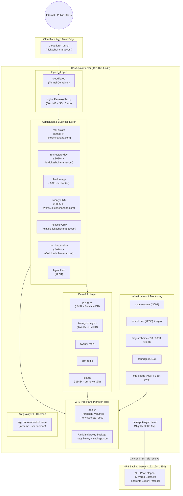

# Casa-poki Infrastructure & Service Architecture

Welcome to **Casa-poki**, the unified homelab and production infrastructure server powering real estate applications, customer relationship management (CRM), workflow automations, local AI inference, networking, and home intelligence.

---

## Table of Contents
1. [System Architecture Overview](#1-system-architecture-overview)
2. [Storage & Secrets Architecture](#2-storage--secrets-architecture)
3. [Backup, Replication & Disaster Recovery](#3-backup-replication--disaster-recovery)
4. [Service Catalog & Deep Dives](#4-service-catalog--deep-dives)
   - [Reverse Proxy & Ingress (`nginx`, `cloudflared`)](#reverse-proxy--ingress)
   - [CRM Stack (`twenty`, `relaticle`, `postgres-db`)](#crm-stack)
   - [Automation & AI (`ai/n8n`, `agents`, `ollama`)](#automation--ai-stack)
   - [Public Web Services (`real-estate`, `checkin`)](#public-web-services)
   - [Observability & Monitoring (`monitor`)](#observability--monitoring)
   - [Network & Home Infrastructure (`adguard`, `habridge`, `mic-bridge`)](#network--home-infrastructure)
   - [Antigravity AI Agent Instance](#antigravity-ai-agent-instance)
5. [Port Matrix & Routing](#5-port-matrix--routing)
6. [Bare-Metal Restore & Disaster Recovery Instructions](#6-bare-metal-restore--disaster-recovery-instructions)
7. [Operational & Safety Rules](#7-operational--safety-rules)

---

## 1. System Architecture Overview



---

## 2. Storage & Secrets Architecture

Casa-poki segregates application code from persistent state and credentials using a dedicated ZFS storage pool.

### ZFS Pool: `tank`
- **Physical Drive**: Dedicated 500GB SSD (`/dev/sda`).
- **Mountpoint**: `/tank`.
- **Datasets**:
  | Dataset | Mountpoint | Purpose |
  | :--- | :--- | :--- |
  | `tank` | `/tank` | Root dataset (contains `twenty`, `mic-bridge`, `cloudflared`, `antigravity-backup`) |
  | `tank/adguard` | `/tank/adguard` | AdGuard Home DNS configurations and query logs |
  | `tank/habridge` | `/tank/habridge` | HA-Bridge device definitions and rules |
  | `tank/monitor` | `/tank/monitor` | Uptime Kuma SQLite database and Beszel metrics store |
  | `tank/n8n` | `/tank/n8n` | n8n workflow engine SQLite database, custom nodes, storage |
  | `tank/npm` | `/tank/npm` | Nginx configuration files (`conf.d/`) and Let's Encrypt certificates (`certs/`) |
  | `tank/ollama` | `/tank/ollama` | Ollama LLM model weights (`crm-qwen:3b`) |
  | `tank/postgres-db` | `/tank/postgres-db` | PostgreSQL 17 data directory for Relaticle CRM |
  | `tank/re_office_data`| `/tank/re_office_data` | Office 365 OAuth tokens and sync state |
  | `tank/relaticle` | `/tank/relaticle` | Relaticle CRM file storage, OAuth keys, and Redis append-only files |

### Secrets Hygiene
- **Strict Isolation**: No secret, API key, password, or `.env` file is ever committed to Git.
- **Physical Location**: All service secrets reside directly in `/tank/<service>/.env` with strict `0600` permissions (`lokesh:lokesh`).
- **Symlink Wiring**: Repositories connect to secrets via symlinks (`/home/lokesh/Casa-poki/<service>/.env -> /tank/<service>/.env`).
- **Templates**: Every service repository includes a clean, sanitized `.env.example` defining variable requirements for documentation and fresh deployments.

---

## 3. Backup, Replication & Disaster Recovery

Casa-poki utilizes native, block-level ZFS snapshot replication to a separate physical ZFS storage server.

### Backup Server Configuration
- **Host**: `192.168.1.250` (`casa-poki-nfs`)
- **Storage**: ZFS pool `nfspool` (899 GB available)
- **NFS Share**: `192.168.1.250:/nfspool` exported to `192.168.1.0/24` with `no_root_squash`

### Automated Nightly Synchronization
- **Engine**: `/usr/local/bin/casa-poki-sync.sh` (versioned at `scripts/casa-poki-sync.sh`)
- **Schedule**: `casa-poki-sync.timer` triggers every morning at **02:00 AM**.
- **Execution Workflow**:
  1. Copies current Antigravity binary (`~/.local/bin/agy`), user settings (`~/.gemini`), and daemon unit to `/tank/antigravity-backup/`.
  2. Finds the latest common snapshot between `tank` and remote `nfspool`.
  3. Creates a new recursive snapshot `tank@daily-YYYYMMDD-HHMMSS`.
  4. Streams an incremental recursive ZFS package:
     ```bash
     zfs send -R -I tank@<previous> tank@daily-<today> | ssh root@192.168.1.250 "zfs receive -F -d nfspool"
     ```
  5. Automatically prunes snapshots older than 14 days on both source and destination pools.
  6. Logs execution output to `/var/log/casa-poki-sync.log`.

---

## 4. Service Catalog & Deep Dives

### Reverse Proxy & Ingress
- **`nginx`** (`nginx/`):
  - Image: `nginx:alpine`
  - Ports: `80:80`, `443:443`
  - Volumes: `/tank/npm/conf.d:/etc/nginx/conf.d:ro`, `/tank/npm/certs:/etc/nginx/certs:ro`
  - SSL Automation: Wildcard certificates for `*.lokeshchanana.com` are auto-renewed daily via `/etc/cron.daily/certbot-renew` using Cloudflare DNS verification.
- **`cloudflared`** (`cloudflared/`):
  - Image: `cloudflare/cloudflared:latest`
  - Outbound zero-trust tunnel routing public traffic directly into internal services without forwarding ports on the router.

### CRM Stack
- **`twenty`** (`twenty/`):
  - Services: `twenty-server` (:8085), `twenty-worker`, `twenty-postgres`, `twenty-redis`
  - Configuration: Self-hosted Twenty CRM connected to Brevo email marketing and automated n8n webhooks.
  - Storage: `/tank/twenty/data`, `/tank/twenty/db`, `/tank/twenty/redis`.
- **`relaticle`** (`relaticle/`):
  - Services: `crm-app` (:8085 internal), `crm-horizon`, `crm-scheduler`, `crm-redis`
  - Stack: Laravel, Filament PHP, Redis queue worker.
  - Storage: `/tank/relaticle/storage`, `/tank/relaticle/redis`.
- **`postgres-db`** (`postgres-db/`):
  - Image: `postgres:17-alpine` on port `5432`.
  - Serves as the primary relational database for Relaticle.
  - Storage: `/tank/postgres-db/data`.

### Automation & AI Stack
- **`ai/n8n`** (`ai/n8n/`):
  - Image: `docker.n8n.io/n8nio/n8n:latest` on port `5678`.
  - Fully integrated with Gemini API (`GEMINI_API_KEY`), Twenty CRM, Google Sheets, Brevo, and Google Business Profile.
  - Storage: `/tank/n8n`.
- **`agents`** (`agents/`):
  - Service: `agent-hub` on port `8094`.
  - Autonomous background agent system reading n8n SQLite catalog, scheduling tasks, and executing local tool operations.
- **`ollama`** (`ollama/`):
  - Service: `ollama` on port `11434`.
  - Runs local model `crm-qwen:3b` for privacy-first CRM categorization and text completions.
  - Storage: `/tank/ollama/model`.

### Public Web Services
- **`real-estate`** (`real-estate/`):
  - Production website: `real-estate` on port `8088` (`https://lokeshchanana.com`).
  - Staging website: `real-estate-dev` on port `8089` (`https://dev.lokeshchanana.com`).
  - Stack: React, Vite, Tailwind CSS, pre-rendered routes, VCF contact card generator, Instagram Reels dynamic sync.
  - **Mandatory Workflow**: Dev-before-prod. Never modify production without review on dev.
- **`checkin`** (`checkin/`):
  - Service: `checkin-app` on port `8091`.
  - Responsive visitor sign-in kiosk app used during open houses, pushing leads instantly to n8n and Twenty CRM.

### Observability & Monitoring
- **`monitor`** (`monitor/`):
  - **Beszel Hub** (`beszel` on port `8095` -> `8090` internal, public at `beszel.lokeshchanana.com`) + **Beszel Agent** (`beszel-agent` in host mode on port `45876`) for system CPU, memory, disk, and docker container stats.
  - **Uptime Kuma** (`uptime-kuma` on port `3001:3001`) with persistent SQLite storage in `/tank/monitor/uptime-kuma`, monitoring uptime for all local and external services.

### Network & Home Infrastructure
- **`adguard`** (`adguard/`):
  - Network-wide DNS sinkhole on port `53` (TCP/UDP), web interface on `:8053`, and initial setup on `:3030`.
- **`habridge`** (`habridge/`):
  - Philips Hue emulator on port `9123` for smart home device bridging.
- **`mic-bridge`** (`mic-bridge/`):
  - Python ALSA audio capture bridge with FFT frequency analysis publishing real-time beat/volume metrics to Home Assistant over MQTT.

### Antigravity AI Agent Instance
- **Daemon**: `/home/lokesh/.local/bin/agy remote-control serve`
- **Systemd User Service**: `antigravity-cli-daemon.service`
- **Persistence**: User session lingering enabled (`loginctl enable-linger lokesh`), ensuring agents run continuously across server reboots.
- **Config & Brain**: `~/.gemini/antigravity-cli/settings.json`.

---

## 5. Port Matrix & Routing

| Port | Service Container | Internal Destination | Public Hostname (Cloudflare/Nginx) |
| :--- | :--- | :--- | :--- |
| **80 / 443** | `nginx` | Host Nginx Ingress | Local LAN / SSL Termination |
| **3001** | `uptime-kuma` | Uptime Monitor UI | `status.lokeshchanana.com` |
| **3030 / 8053** | `adguardhome` | AdGuard Web UI | Local LAN (`http://192.168.1.240:8053`) |
| **5432** | `postgres` | PostgreSQL 17 DB | Internal docker network (`postgres-network`) |
| **5678** | `n8n` | n8n Automation Engine | `https://n8n.lokeshchanana.com` |
| **8085** | `twenty-server` | Twenty CRM Server | `https://twenty.lokeshchanana.com` |
| **8088** | `real-estate` | Production Real Estate Web | `https://lokeshchanana.com` |
| **8089** | `real-estate-dev` | Staging Real Estate Web | `https://dev.lokeshchanana.com` |
| **8091** | `checkin-app` | Open House Sign-In Web | `https://checkin.lokeshchanana.com` |
| **8094** | `agent-hub` | Autonomous Agent Hub | Internal LAN (`http://192.168.1.240:8094`) |
| **8095** | `beszel` | Beszel Metrics Hub | `https://beszel.lokeshchanana.com` |
| **9123** | `habridge` | HA-Bridge IoT Emulator | Local LAN (`http://192.168.1.240:9123`) |
| **11434**| `ollama` | Local LLM Engine | Internal LAN (`http://192.168.1.240:11434`) |
| **45876**| `beszel-agent` | Beszel Metric Exporter | Localhost / Internal metrics |

---

## 6. Bare-Metal Restore & Disaster Recovery Instructions

If the physical server suffers total hardware failure, you can rebuild the entire Casa-poki environment on a fresh Ubuntu 22.04 LTS or 24.04 LTS machine with a single command.

### Automated One-Command Recovery
On a fresh Ubuntu installation:

```bash
curl -fsSL https://raw.githubusercontent.com/lokeshchanana/Casa-poki/main/scripts/restore-casa-poki.sh | sudo bash
```

Or if you have the repository cloned:

```bash
sudo /home/lokesh/Casa-poki/scripts/restore-casa-poki.sh
```

### What the Restore Engine Automates:
1. **Package Provisioning**: Installs `zfsutils-linux`, `docker.io`, `docker-compose-plugin`, `nfs-common`, `git`, `rsync`, and `jq`.
2. **User Account**: Configures user `lokesh` with passwordless Docker and sudo access.
3. **ZFS Tank Recovery**:
   - Detects and re-imports an existing physical drive (`zpool import -f tank`), **OR**
   - Receives the latest ZFS snapshot stream from `192.168.1.250` onto a new disk, **OR**
   - Mounts `192.168.1.250:/nfspool` directly over NFS.
4. **Secrets & Symlinks Restoration**: Automatically links `/tank/<service>/.env` to `/home/lokesh/Casa-poki/<service>/.env`.
5. **Docker Infrastructure**: Recreates required external bridge networks (`postgres-network`, `relaticle-internal`).
6. **Antigravity AI Environment**:
   - Restores the `agy` binary to `~/.local/bin/agy`.
   - Restores configuration and `settings.json` to `~/.gemini/antigravity-cli/`.
   - Restores and activates `antigravity-cli-daemon.service` under user systemd.
   - Enables persistent user lingering (`loginctl enable-linger lokesh`).
7. **Container Startup**: Launches all 13 application stacks in strict dependency order with automated health verification.
8. **Replication Activation**: Installs and activates `casa-poki-sync.timer` for ongoing 02:00 AM nightly replication.

### Manual Maintenance & Verification Commands

- **Run an Instant ZFS Replication to NFS Server**:
  ```bash
  sudo /usr/local/bin/casa-poki-sync.sh
  ```
- **Check Replication Status & Logs**:
  ```bash
  systemctl status casa-poki-sync.timer
  cat /var/log/casa-poki-sync.log | tail -n 30
  ```
- **Inspect Remote Snapshots on NFS Server**:
  ```bash
  ssh root@192.168.1.250 'zfs list -t snapshot -r nfspool'
  ```
- **Mount Remote /nfspool Over NFS Manually**:
  ```bash
  sudo mkdir -p /tank
  sudo mount -t nfs 192.168.1.250:/nfspool /tank
  ```

---

## 7. Operational & Safety Rules

All automated agents, scripts, and developers working on Casa-poki must strictly follow these rules:

1. **Zero Stray Communications (Live Safety)**:
   - All production services (CRM, n8n, Relaticle, Check-in, Webhooks, Real Estate) are LIVE.
   - Never use fake or random emails/numbers. If any test triggers an email or SMS, **ONLY** use verified owner details:
     - **Email:** `lokeshchanana@gmail.com`
     - **Phone:** `8018601052`
   - Test records inserted into Twenty CRM or databases must be deleted immediately after verification.
2. **Dev-Before-Production Promotion**:
   - Website changes must be staged on `dev.lokeshchanana.com` (`real-estate-dev` on port 8089) first.
   - Never rebuild `real-estate` production container without explicit user approval.
3. **Plan-First Execution**:
   - Multi-step tasks or architecture modifications require a clear plan approved before execution.
4. **Mandatory Post-Task Sync & Secret Hygiene**:
   - All secrets must reside on `/tank/<service>/.env` (`0600`), never staged in Git.
   - Code changes must be committed and pushed to `https://github.com/lokeshchanana/Casa-poki.git`.
   - Maintain the nightly replication (`casa-poki-sync.timer`) to `192.168.1.250`.
