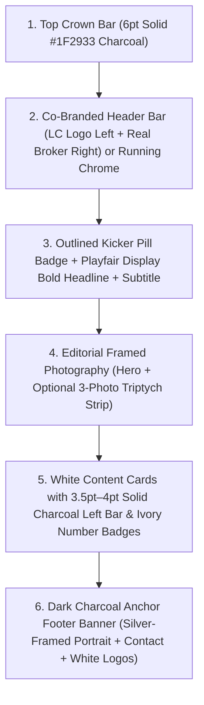

# Lokesh Chanana (Loki) — Master Brand & Design Guidelines
**Version 2.0 • Online, Digital Products (Light & Dark Mode) & Offline Print Marketing**  
**Owner:** Lokesh Chanana (Loki) — REALTOR®, Real Broker LLC (WA License `#26006634`)  
**Primary Domain:** `https://lokeshchanana.com`  
**Contact:** `(801) 860-1052` • `lokesh@lokeshchanana.com` / `hello@lokeshchanana.com`

---

## 1. Brand Foundation, Positioning & Identity

### 1.1 Core Brand Essence
- **Brand Archetype:** *The Trusted Neighbor & Strategic Enabler* — combining analytical market rigor and architectural editorial polish with warm, approachable, everyday human connection.
- **Target Audience & Market Reality:** Everyday, hardworking home buyers, sellers, and homeowners across Greater Seattle & the Puget Sound region (`$550k–$1.1M` residential communities across Renton, Puyallup, Des Moines, Redmond, Shoreline, Kent, Auburn, Bothell, Kirkland, Bellevue, Seattle, and Tacoma).
- **Visual North Star:** *"Approachable Pacific Northwest Editorial"* — inspired by the **Classic Home Maintenance Guide PDF** and **`lokeshchanana.com`**. Layouts pair warm architectural neutrals (`#FAF8F5` Ivory, `#1F2933` Charcoal, `#C0C0C0` Silver), classic editorial serif headlines (`Playfair Display`), geometric sans-serif kickers/body (`Plus Jakarta Sans`), structured 4pt left-accent cards, and authentic Puget Sound neighborhood photography.

### 1.2 Mandatory Identity & Legal Credentials
Every marketing asset (print flyer, postcard, poster, yard sign, PDF guide, website footer, social bio, or email template) must include:
- **Agent Name:** `Lokesh Chanana` or `Lokesh Chanana (Loki)`
- **Title:** `REALTOR®` / `Real Estate Agent` / `Real Estate Broker`
- **Brokerage Name (WA RCW 18.85 Compliance):** `Real Broker LLC` (must be clearly legible and prominent alongside the agent name/brand).
- **License Number (Print Guides, Footers & Formal Collateral):** `LIC #26006634` (Washington State).
- **Team Affiliation (Where Applicable):** `Lakhani Team Realtors` (`lakhani-logo.png`).
- **Fair Housing Statement (Print Brochures, Postcards & Website Footers):** *"Equal Housing Opportunity. Information deemed reliable but not guaranteed. All real estate advertising is subject to the Federal Fair Housing Act."*

---

## 2. Brand Voice, Tone & Copywriting Playbook

### 2.1 Voice Principles
1. **Warm, Friendly & Fun to Read:** Write like a knowledgeable friend who happens to be an expert real estate strategist. Use natural transitions, relatable homeowner moments (*"Once the moving truck pulls away and the pizza boxes are recycled..."*), and conversational warmth.
2. **Proactive & Protective:** Frame advice around protecting the client's wallet, comfort, and peace of mind (*"prevent small quirks from turning into expensive headaches down the road"*).
3. **Zero Pushy Sales Jargon:** Never use high-pressure clichés (*"ACT NOW BEFORE IT'S GONE!!"*). Instead, offer genuine value, clear data, and an open door (*"I'm only a phone call away—here for you beyond the sale"*).

### 2.2 Copywriting Formulas by Element
| Element | Formula & Style | Examples |
| :--- | :--- | :--- |
| **Kicker Badge** | `2–4 words`, ALL CAPS, wide letter-spacing (`0.15em–0.20em`), establishes context | `GREATER SEATTLE SPECIALISTS` • `PROTECT YOUR INVESTMENT` • `OPEN HOUSE THIS WEEKEND` • `JUST SOLD IN RENTON` |
| **Primary Headline (H1/H2)** | `Playfair Display Bold`, Title Case, optional *Italic* second line for emotional emphasis | **Dedicated, Proactive** *Home Maintenance Guide.* / **Dedicated, Personalized** *Real Estate Service.* |
| **Card Title (H3)** | `Playfair Display Bold`, concise action-oriented phrase (`3–6 words`) | `Save Money Over Time` • `Show Your Filters Some Love` • `Offer Engineering` |
| **Body Copy** | `Plus Jakarta Sans Regular`, `2–3 sentences` per paragraph max, clear and conversational | *"Your home is your biggest investment, and a little routine love goes a long way."* |
| **Sign-Off / CTA** | Warm, low-pressure invitation with direct phone/text access | *"Have questions or need a trusted local contractor recommendation? Call or text me anytime at (801) 860-1052."* |

---

## 3. Logo System, Co-Branding & Alpha-Mask Rules

### 3.1 Master Logo Assets
1. **Primary Personal Monogram (`public/lc-logo.png`):**
   - Intricate calligraphic `LC` script monogram above `LOKESH CHANANA (LOKI)` wordmark.
   - Native file has light silver/grey pixels (`~RGB 183`) with a transparent alpha channel.
2. **Brokerage Logo (`public/real-logo.png`):**
   - Geometric `real` wordmark with architectural corner bracket (`Real Broker LLC`).
   - Native file is black pixels (`RGB 0`) on an opaque white (`RGB 255`) background.
3. **Team Logo (`public/lakhani-logo.png`):**
   - Used in website footers and co-branded digital sections.

### 3.2 Critical Logo Rendering Rules (Print & Digital)
- **NEVER Render Opaque Rectangular Boxes Around Logos:**
  - In PDF/Print generation (PyMuPDF / Pillow / InDesign), **always extract the alpha mask** of `lc-logo.png` and `real-logo.png` (`lum = 255 - grayscale` for `real-logo.png`) and composite pure target ink directly onto the background surface:
    - **On Light Surfaces (`#FAF8F5` Ivory or `#FFFFFF` White):** Render logos in solid **Architectural Charcoal (`#1F2933`)**.
    - **On Dark Surfaces (`#1F2933` Charcoal or `#151C23` Charcoal Dark):** Render logos in solid **Warm Ivory (`#FAF8F5`)** or **Silver (`#C0C0C0`)**.
  - **In Web / CSS (Tailwind):**
    - `real-logo.png`: Use `className="object-contain dark:invert"` when placed on white in light mode and dark charcoal in dark mode.
    - `lakhani-logo.png`: Use `className="object-contain invert dark:invert-0"`.
- **Clear Space & Minimum Sizing:**
  - Maintain a minimum clear-space margin equal to `25%` of the logo's height on all four sides.
  - **Minimum Print Width:** `0.75 in` (`54 pt`) for `lc-logo.png`; `0.85 in` (`61 pt`) for `real-logo.png`.
  - **Minimum Digital Height:** `64 px` (`h-16`) on mobile headers; `80 px` (`h-20`) on desktop headers.

---

## 4. Master Color System (Digital Light/Dark + Print CMYK + Pantone)

### 4.1 Core Architectural Palette (Shared Across Print & Digital)

| Color Token | Swatch Role | HEX | RGB | Print CMYK (Coated / Uncoated) | Pantone (PMS) Match |
| :--- | :--- | :--- | :--- | :--- | :--- |
| **`ivory` (DEFAULT)** | Primary Light Canvas / Print Page Background | `#FAF8F5` | `250, 248, 245` | `C:0 M:1 Y:3 K:2` | `PMS Warm Gray 1 C (10% tint)` / `7527 U` |
| **`ivory-dark`** | Secondary Light Surface / Section Divider Fill | `#E5E1DB` | `229, 225, 219` | `C:0 M:2 Y:6 K:10` | `PMS Warm Gray 2 C` / `Warm Gray 2 U` |
| **`white`** | Elevated Card Surface (Light Mode & Print Cards) | `#FFFFFF` | `255, 255, 255` | `C:0 M:0 Y:0 K:0` | Paper White |
| **`charcoal` (DEFAULT)** | Primary Dark Ink (Light Mode) / Primary Canvas (Dark Mode) / Structural Accent Bars | `#1F2933` | `31, 41, 51` | `C:78 M:64 Y:52 K:62` *(Rich Black/Charcoal)* | `PMS 432 C` / `2379 C` |
| **`charcoal-dark`** | Deepest Surface (Dark Mode Elevated Cards / Header / Print Callout Inner Boxes) | `#151C23` | `21, 28, 35` | `C:82 M:68 Y:55 K:74` | `PMS 433 C` / `433 U` |
| **`charcoal-light`** | Secondary Body Copy & Subtitles (Light Mode & Print) | `#2D3A47` | `45, 58, 71` | `C:72 M:55 Y:42 K:40` | `PMS 7545 C` / `7545 U` |
| **`silver` (DEFAULT)** | Primary Headlines & Icons in Dark Mode / Portrait Borders | `#C0C0C0` | `192, 192, 192` | `C:0 M:0 Y:0 K:25` | `PMS 877 C (Metallic)` / `Cool Gray 4 C` |
| **`silver-light`** | Hairline Card Borders & Section Rules (`0.8pt` / `1px`) | `#E0E0E0` | `224, 224, 224` | `C:0 M:0 Y:0 K:12` | `PMS Cool Gray 2 C` |
| **`silver-dark`** | Muted Captions, Running Headers, Form Labels & Dark Mode Body Copy | `#A0A0A0` *(Web)* / `#8C8E91` *(Print)* | `160, 160, 160` / `140, 142, 145` | `C:0 M:0 Y:0 K:45` | `PMS Cool Gray 7 C` |
| **`silver-border` (Photo)** | 2px Editorial Photo Frame Border in Print/PDF | `#D6D3CD` | `214, 211, 205` | `C:0 M:1 Y:4 K:16` | `PMS Warm Gray 3 C` |

### 4.2 Secondary Digital & Transactional Email Accent Palette
Used exclusively for HTML transactional/drip emails (Brevo) and functional status indicators:
- **Email Header Slate Navy:** `#0F172A` (`RGB 15, 23, 42`)
- **Email Accent Cyan / Sky:** `#06B6D4` (`RGB 6, 182, 212`) border accent & `#38BDF8` (`RGB 56, 189, 248`) kicker text
- **Email Callout Box Surface:** `#F0F9FF` (`RGB 240, 249, 255`) with `4px` solid `#06B6D4` left border
- **Digital Status Tokens (Forms & UI):**
  - **Success:** `#059669` (`emerald-600` Light) / `#34D399` (`emerald-400` Dark) on `bg-emerald-50 dark:bg-emerald-950/40`
  - **Error / Required:** `#E11D48` (`rose-600` / `red-700` Light) / `#FCA5A5` (`red-300` Dark) on `bg-red-50 dark:bg-red-950/40`
  - **Theme Toggle Icons:** Sun icon in `#FBBF24` (`text-amber-400`) in Dark Mode; Moon icon in `#334155` (`text-slate-700`) in Light Mode.

### 4.3 Print Ink & Paper Stock Specifications
- **Rich Charcoal Ink Warning:** Never print `#1F2933` as `100% K` (which looks washed-out grey) or `100% C/M/Y/K` (which oversaturates paper). Always use the calibrated 4-color rich charcoal formula **`C:78 M:64 Y:52 K:62`** (Total Area Coverage `256%`, safe for both coated and uncoated presses).
- **Recommended Paper Stocks:**
  - **Property Flyers & Brochures (`8.5" × 11"`):** `100 lb Matte Text` or `100 lb Silk/Satin Text` (`148 gsm`).
  - **Multi-Page Client Guides (Printed Booklets):** Cover on `100 lb Uncoated Cover` (`270 gsm`, e.g., Mohawk Superfine Eggshell Ultrawhite or Warm White); Interior on `80 lb Uncoated Text` (`118 gsm`).
  - **Direct Mail Postcards (`6" × 9"` / `6" × 11"`):** `16 pt C2S Matte Cardstock` with Satin Aqueous Coating (or UV coating on front photo side only; leave back uncoated for inkjet addressing).
  - **Yard Signs & Directional Riders (`18" × 24"` / `24" × 36"`):** `3mm Aluminum Composite (ACM / Dibond)` with matte anti-glare lamination for main listings; `4mm Coroplast` for Open House A-frames.

---

## 5. Digital Product Architecture: Light Mode vs. Dark Mode (`lokeshchanana.com`)

### 5.1 Theme Resolution Mechanics
- The website uses class-based dark mode (`darkMode: 'class'` in `tailwind.config.js`), managed by `ThemeContext.jsx`.
- **Default Behavior:** Defaults to `'system'` (`window.matchMedia('(prefers-color-scheme: dark)')`), automatically syncing with the user's OS/device appearance while allowing manual override via the header Sun/Moon toggle (`localStorage.getItem('theme')`).
- **Transition Standard:** All structural containers and interactive elements must include `transition-colors duration-300` (or `duration-500` on the sticky header) so switching between Light and Dark Mode feels smooth and architectural.

### 5.2 Complete Light Mode vs. Dark Mode Semantic Token Matrix

| UI Surface / Element | Light Mode Token & HEX | Dark Mode Token & HEX | Exact Tailwind CSS Class Pairing |
| :--- | :--- | :--- | :--- |
| **Primary Page Canvas** | `ivory` (`#FAF8F5`) | `charcoal` (`#1F2933`) | `bg-ivory dark:bg-charcoal` |
| **Alternating Section / Elevated Card / Footer** | `white` (`#FFFFFF`) | `charcoal-dark` (`#151C23`) | `bg-white dark:bg-charcoal-dark` |
| **Nested Card Inside White/Charcoal-Dark Section** | `ivory` (`#FAF8F5`) | `charcoal` (`#1F2933`) | `bg-ivory dark:bg-charcoal` |
| **Sticky Scrolled Header (Glassmorphism)** | `white/95` (`rgba(255,255,255,0.95)`) | `charcoal-dark/95` (`rgba(21,28,35,0.95)`) | `bg-white/95 dark:bg-charcoal-dark/95 backdrop-blur-md border-b border-silver/20` |
| **Mobile Top Contact Bar** | `charcoal` (`#1F2933`) | `black` (`#000000`) | `bg-charcoal dark:bg-black text-ivory dark:text-silver` |
| **Primary Headlines (H1, H2, H3) & Active Text** | `charcoal` (`#1F2933`) | `silver` (`#C0C0C0`) | `text-charcoal dark:text-silver` |
| **Body Copy, Subtitles & Nav Links (Default)** | `charcoal-light` (`#2D3A47`) | `silver-dark` (`#A0A0A0`) | `text-charcoal-light dark:text-silver-dark` |
| **Muted Kickers, Labels & Copyright Text** | `silver-dark` (`#A0A0A0`) | `silver-dark` (`#A0A0A0`) | `text-silver-dark uppercase tracking-widest` |
| **Standard Card / Section Hairline Border** | `silver` @ `30%` opacity | `silver` @ `10%–20%` opacity | `border border-silver/30 dark:border-silver/20` |
| **Interactive Card Hover Border** | `charcoal` (`#1F2933`) | `silver` (`#C0C0C0`) | `hover:border-charcoal dark:hover:border-silver` |
| **Signature Callout Box Left Accent Bar (`4px`)** | `charcoal` (`#1F2933`) | `silver` (`#C0C0C0`) | `bg-white dark:bg-charcoal-dark p-6 border border-silver/30 border-l-4 border-l-charcoal dark:border-l-silver` |
| **Hero Kicker Pill Badge** | `charcoal/20` border | `silver/20` border | `border border-charcoal/20 dark:border-silver/20 text-charcoal-light dark:text-silver-dark` |
| **Hero Background Image & Fade Overlay** | `opacity-60 grayscale` → `to-ivory` | `opacity-50 grayscale` → `to-charcoal` | `bg-gradient-to-b from-transparent to-ivory dark:to-charcoal` |
| **Primary Solid CTA Button (Submit / Action)** | `charcoal` fill, `ivory` text | `silver` fill, `charcoal` text | `bg-charcoal hover:bg-charcoal-light dark:bg-silver dark:hover:bg-white text-ivory dark:text-charcoal` |
| **Secondary Outlined CTA Button (Card Action)** | `charcoal` border & text → `charcoal` fill on hover | `silver` border & text → `silver` fill on hover | `border border-charcoal dark:border-silver text-charcoal dark:text-silver hover:bg-charcoal hover:text-ivory dark:hover:bg-silver dark:hover:text-charcoal` |
| **Minimalist Form Input (Bottom-Border Style)** | `ivory` bg, `silver/50` bottom border → `charcoal` focus | `charcoal` bg, `silver/30` bottom border → `silver` focus | `bg-ivory dark:bg-charcoal border-b border-silver/50 dark:border-silver/30 text-charcoal dark:text-silver focus:border-charcoal dark:focus:border-silver` |
| **Icon Badge Box (Contact / Resource Overlay)** | `silver/40` border → `charcoal` fill on hover | `silver/20` border → `silver` fill on hover | `border border-silver/40 dark:border-silver/20 text-charcoal dark:text-silver group-hover:bg-charcoal group-hover:text-ivory dark:group-hover:bg-silver dark:group-hover:text-charcoal` |

---

## 6. Typography & Editorial Hierarchy System

### 6.1 Font Families
1. **Editorial Display Serif (`font-serif`):**
   - **Primary Font:** `Playfair Display` (Weights: `400 Regular`, `400 Italic`, `600 SemiBold`, `600 SemiBold Italic`, `700 Bold`).
   - **Web / System Fallbacks:** `'Playfair Display', 'Palatino Linotype', Palatino, Georgia, serif`.
   - **Usage:** All H1/H2/H3 headlines, cover titles, italic sub-headlines, numbered card badges (`01`, `02`, `03`), page-number badges, running header document titles, and agent name signatures.
2. **Geometric UI & Body Sans-Serif (`font-sans`):**
   - **Primary Font:** `Plus Jakarta Sans` (Weights: `400 Regular`, `500 Medium`, `600 SemiBold`, `700 Bold`, `800 ExtraBold`).
   - **Web / Email Fallbacks:** `'Plus Jakarta Sans', Montserrat, -apple-system, BlinkMacSystemFont, 'Segoe UI', Roboto, sans-serif`.
   - **Usage:** Uppercase tracked kicker badges, body paragraphs, bullet points, interactive checklist items, navigation links, buttons, form inputs, and footer metadata.

### 6.2 Master Type Scale (Print `pt` vs. Web/Digital `px`/`rem`)

| Hierarchy Level | Font Family & Weight | Print Size (`8.5"×11"`) | Poster/Sign (`18"×24"`) | Web / Digital (`px` / Tailwind) | Line Height | Letter Spacing |
| :--- | :--- | :--- | :--- | :--- | :--- | :--- |
| **Display Cover Title (H1)** | `Playfair Display Bold` (+ *Italic* line 2) | `26 pt – 30 pt` | `72 pt – 96 pt` | `36px–60px` (`text-4xl lg:text-6xl`) | `1.10 – 1.15` | `-0.01em` |
| **Section Headline (H2)** | `Playfair Display Bold` | `21 pt – 23 pt` | `48 pt – 60 pt` | `30px–48px` (`text-3xl md:text-5xl`) | `1.12 – 1.18` | `0em` |
| **Card / Feature Title (H3)** | `Playfair Display Bold` | `11.5 pt – 13.5 pt` | `28 pt – 34 pt` | `20px–24px` (`text-xl md:text-2xl`) | `1.20` | `+0.01em` |
| **Kicker Pill Badge** | `Plus Jakarta Sans Bold` (ALL CAPS) | `7.2 pt – 7.8 pt` | `18 pt – 22 pt` | `10px–11px` (`text-[10px] tracking-[0.2em]`) | `1.0` | `+0.15em – 0.20em` |
| **Lead / Subtitle Copy** | `Plus Jakarta Sans Regular` | `10.0 pt – 10.5 pt` | `24 pt – 28 pt` | `16px–18px` (`text-base md:text-lg`) | `1.36 – 1.60` | `0em` |
| **Standard Body Copy** | `Plus Jakarta Sans Regular` | `9.2 pt – 9.8 pt` | `20 pt – 22 pt` | `14px–16px` (`text-sm md:text-base`) | `1.33 – 1.55` | `0em` |
| **Checklist / Table Item** | `Plus Jakarta Sans Medium` | `8.4 pt – 8.8 pt` | `18 pt` | `13px–14px` (`text-xs md:text-sm`) | `1.22 – 1.30` | `0em` |
| **Running Header / Footer / Legal** | `Plus Jakarta Sans Medium` / `PF Italic` | `7.5 pt – 8.5 pt` | `14 pt – 16 pt` | `10px–12px` (`text-[10px] md:text-xs`) | `1.25` | `+0.08em – 0.12em` |

---

## 7. Signature Structural Components (The "Classic Guide" Design Language)

Every flyer, brochure, guide, postcard, or social carousel must be assembled from these 6 signature building blocks:

### 7.1 Component Specifications (Exact Measurements for `8.5" × 11"` / `612 × 792 pt`)
1. **Page Canvas & Crown Bar:**
   - Full-bleed background fill in **Warm Ivory (`#FAF8F5`)**.
   - Top edge anchored by a **`6 pt` (`0.083"`) solid `#1F2933` Charcoal crown bar** spanning the full width (`0` to `PAGE_W`).
   - Standard outer page margin: **`36 pt` (`0.5 in`)** on all sides (`content width = 540 pt`).
2. **Running Header & Footer Chrome (Multi-Page Guides & Flyers):**
   - **Top Running Bar (`y = 14–32 pt`):** Left side in `7.5 pt` `Plus Jakarta Sans Bold` uppercase (`LOKESH CHANANA  •  <SECTION TOPIC>`); right side in `8.5 pt` `Playfair Display Italic` (`#8C8E91` Silver Dark); bottom hairline rule at `y = 32 pt` (`0.8 pt` `#E0E0E0`).
   - **Bottom Running Footer (`y = PAGE_H - 36 pt`):** Top hairline rule (`0.8 pt` `#E0E0E0`), contact line (`Lokesh Chanana (Loki)  •  REALTOR®  •  Real Broker LLC   |   (801) 860-1052   |   lokeshchanana.com`), and a solid `#1F2933` Charcoal square page-number badge (`26 × 16 pt`) on the far right with `#FAF8F5` Ivory `Playfair Display Bold` digits (`01`, `02`).
3. **Outlined Kicker Pill Badge:**
   - Height `17 pt`, dynamic width (`text_len * 4.7 + 20 pt`), `#FFFFFF` White fill, `0.8 pt` `#E0E0E0` Silver border, `7.5 pt` `Plus Jakarta Sans Bold` uppercase in `#1F2933` Charcoal.
4. **Signature Numbered Content Card (`draw_numbered_card`):**
   - Outer rectangle: `#FFFFFF` White fill, `0.8 pt` `#E0E0E0` Silver border.
   - **Left Accent Bar:** `3.5 pt – 4.0 pt` solid `#1F2933` Charcoal bar flush against the left edge (`x0` to `x0 + 3.5`).
   - **Number Badge:** `22 × 22 pt` square at `(x0 + 13, y0 + 11)` filled with `#FAF8F5` Ivory, `0.7 pt` `#E0E0E0` border, centered `9.2 pt` `Playfair Display Bold` number (`01`, `02`, `03`).
   - **Card Title & Body:** Title at `x0 + 44` in `11.5 pt` `Playfair Display Bold` (`#1F2933`); Body below in `9.5 pt` `Plus Jakarta Sans Regular` (`#2D3A47`).
5. **Dark Charcoal Tip / Callout Box:**
   - Outer container in solid `#1F2933` Charcoal with `13.5 pt` `Playfair Display Bold` title in `#FAF8F5` Ivory.
   - Inner 2×2 grid of sub-cards in `#151C23` Charcoal Dark with `0.7 pt` `#2D3A47` border, bullet title in `#FAF8F5` Ivory (`Plus Jakarta Sans Bold`), and description in `#C0C0C0` Silver.
6. **Dark Agent Signature Banner (Cover & Flyer Footer):**
   - Solid `#1F2933` Charcoal block (`height = 70–106 pt`) with a `2.5 pt` `#C0C0C0` Silver top accent line.
   - Left portrait (`loki-profile.jpg`) cropped square (`52×52 pt` on front cover, `76×84 pt` on back cover) with a `1.2–1.5 pt` `#C0C0C0` Silver border.
   - Agent Name in `14–16.5 pt` `Playfair Display Bold` (`#FAF8F5` Ivory), role/license in `7.5–9 pt` `Plus Jakarta Sans SemiBold` (`#C0C0C0` Silver), and direct clickable contact details in `#FAF8F5` Ivory.

---

## 8. Photography Direction & Automated Color-Grading Formula

### 8.1 Subject Matter Mandate ("Real Puget Sound Homes")
- **Primary Visual Identity (Everyday Client Base):**
  - Always feature relatable, well-kept Greater Seattle & Puget Sound neighborhood homes (`1,100–2,500 sq. ft.` single-family homes, townhomes, and patio homes):
    1. **2000s Suburban Craftsman Two-Story (Renton / Puyallup style):** Greige/taupe horizontal lap & board-and-batten siding, crisp white trim, tapered Craftsman porch columns on stone bases, 2- or 3-car paneled garage, exposed-aggregate driveway, plum trees, hydrangeas, and Douglas fir backdrop.
    2. **1960s/70s Seattle Split-Level / Daylight Rambler (Shoreline style):** Sage/olive siding over lower-level stone/brick masonry, rockery boulder retaining walls, tucked-under 2-car garage, blooming cherry blossoms/rhododendrons, and honey-oak hardwood living rooms with stacked-stone fireplaces.
    3. **1970s/80s Eastside NW Contemporary (Redmond style):** Warm cream/tan vertical grooved cedar siding, angled shed/gable composition shingle rooflines, welcoming raised front porch deck with white railing, and golden autumn maples.
    4. **Single-Story Patio Home / Rambler (Des Moines style):** Soft sage-green horizontal lap siding, white trim, 2-car garage, manicured lawn, and evergreen trees.
    5. **Relatable Refreshed Interiors:** Honey-oak hardwood floors, white shaker kitchens with quartz counters and stainless appliances, clean subway-tile family bathrooms, and fenced backyards with flagstone stepping stones and covered patios.
- **Avoid (Unless Marketing a Specific `$2M+` Luxury Listing):** Ultra-modern glass-box mansions, infinity pools, palm trees, stucco Mediterranean villas, or sterile museum interiors.

### 8.2 Exact Image Color-Grading Pipeline (`editorial_grade`)
To ensure photos from different cameras, MLS shoots, or AI generators look like they belong to the exact same publication, apply this 3-step transformation before placing any image into a layout:
1. **Color Saturation Harmonization:**
   - **Classic / Suburban Edition:** `72%` saturation (`ImageEnhance.Color(im).enhance(0.72)`) — preserves warm oak floors and green lawns while eliminating neon oversaturation.
   - **Luxury Architectural Edition:** `58%` saturation (`ImageEnhance.Color(im).enhance(0.58)`).
2. **Micro-Contrast Boost:**
   - `105%` contrast (`ImageEnhance.Contrast(im).enhance(1.05)`).
3. **Warm Ivory & Deep Charcoal Split-Tone Blend (`16%`):**
   - Compute pixel luminance `L = 0.299*R + 0.587*G + 0.114*B`.
   - Map shadows (`1 - L`) toward **Architectural Charcoal (`#1F2933`)** and highlights (`L`) toward **Warm Ivory (`#FAF8F5`)**:
     $$\text{Tone}(x,y) = (1 - L)\cdot\text{RGB}(31, 41, 51) + L\cdot\text{RGB}(250, 248, 245)$$
     $$\text{Output}(x,y) = 0.84\cdot\text{Image}(x,y) + 0.16\cdot\text{Tone}(x,y)$$
4. **Framing & Overlays:**
   - Frame every editorial photo with a `2 px` (`~0.8 pt`) border in `#D6D3CD` (`SILVER_BORDER_255`) and a subtle `2 pt` corner radius.
   - **Dark Banner Overlay (When Placing Ivory Serif Text Over a Photo):** Apply a vertical linear gradient of `#1F2933` Charcoal from `alpha = 115/255 (45%)` at top to `alpha = 230/255 (90%)` at bottom.
   - **Bottom Ivory Fade (Cover & Website Hero):** Fade the bottom `35%` of the hero image smoothly into `#FAF8F5` Ivory (`alpha = 235 * t^1.6`).

---

## 9. Print Collateral Blueprints (Offline Hard Marketing)

### 9.1 Property Listing & Open House Flyers (`8.5" × 11"` Portrait)
- **Trim Size:** `8.5" × 11"` (`612 × 792 pt`) | **Bleed:** `0.125"` (`9 pt`) on all sides (`8.75" × 11.25"` with bleed) | **Safe Margin:** `0.5"` (`36 pt`).
- **Resolution:** `300 DPI` minimum (`2550 × 3300 px` at trim; `2625 × 3375 px` with bleed).
- **Standard Layout Blueprint:**
  1. **Top (`0–62 pt`):** `6 pt` Charcoal crown bar + `LC` logo left (`36, 18`) + `Real Broker` logo right (`PAGE_W - 110, 24`) + `0.8 pt` Silver divider.
  2. **Header (`74–165 pt`):** Centered Kicker Pill (`OPEN HOUSE • RENTON HIGHLANDS` or `JUST LISTED • OVERLAKE`), Property Street Address in `26 pt` `Playfair Display Bold`, City/Specs subtitle (`4 BD  •  2.5 BA  •  2,490 SQ. FT.  •  OFFERED AT $849,000`) in `10.5 pt` `Plus Jakarta Sans SemiBold` tracked uppercase.
  3. **Photo Showcase (`175–475 pt`):** Main exterior hero (`540 × 195 pt`) above a 3-photo interior triptych (`3 × 174 × 92 pt` with `9 pt` gutters: Living Room, Kitchen, Backyard).
  4. **Property Highlights (`488–668 pt`):** 2-column grid of 4 Signature Numbered Cards (`01` Architecture & Layout, `02` Chef's Kitchen & Updates, `03` Outdoor Living & Lot, `04` Location & Schools) with `3.5 pt` Charcoal left bars.
  5. **Footer (`680–756 pt`):** Solid `#1F2933` Charcoal agent banner with Loki's portrait, contact info, QR code to property page/vCard, and Equal Housing disclosure.

### 9.2 Direct Mail Postcards (`6" × 9"` & `6" × 11"` Landscape — USPS EDDM Compliant)
- **Trim Size:** `9" × 6"` (`648 × 432 pt`) or `11" × 6"` (`792 × 432 pt`) | **Bleed:** `0.125"` on all sides | **Safe Margin:** `0.375"` (`27 pt`).
- **Front Side (Visual Impact):**
  - Left `60%`: Full-bleed graded property/neighborhood photo with a top-left Kicker Pill (`JUST SOLD IN YOUR NEIGHBORHOOD` or `FREE ANNUAL HOME EQUITY REVIEW`).
  - Right `40%`: `#FAF8F5` Ivory panel with `6 pt` `#1F2933` Charcoal top bar, `Playfair Display Bold` headline, 2 numbered highlight cards, and `#1F2933` Charcoal bottom agent strip.
- **Back Side (Message + USPS Addressing Zone):**
  - **Left Half (`52%` width):** Warm neighborly note in `Plus Jakarta Sans Regular`, 3 recent neighborhood sales/stats in numbered cards, and Loki's full signature block + brokerage logos at bottom left.
  - **Right Half (`48%` width):** Mandatory USPS layout — top-right Permit Indicium box (`1.5" × 1.5"`), middle return address, and bottom-right **USPS Barcode & Address Clear Zone (`4.0" W × 2.25" H` must remain 100% pure `#FFFFFF` White with zero ink or borders)**.

### 9.3 Posters, Event Boards & Yard Signs (`18" × 24"` & `24" × 36"`)
- **Distance Legibility Rule:** Yard signs must be readable from a moving car at `40–50 feet` (`3 seconds` glance time). Maximum `4` pieces of information on a yard sign:
  1. **Top Rider (`6" × 24"`):** Solid `#1F2933` Charcoal background with `#FAF8F5` Ivory `Plus Jakarta Sans ExtraBold` (`OPEN SUNDAY 1–4 PM` or `PENDING`).
  2. **Main Sign Panel (`18" × 24"` or `24" × 36"`):**
     - Top `25%`: Solid `#1F2933` Charcoal header with `FOR SALE` in `#FAF8F5` Ivory (`Playfair Display Bold`, `180 pt+`).
     - Middle `50%`: `#FAF8F5` Ivory field with `LOKESH CHANANA (LOKI)` in `Playfair Display Bold`, `(801) 860-1052` in massive `Plus Jakarta Sans ExtraBold`, and `lokeshchanana.com`.
     - Bottom `25%`: Co-branded `LC` Monogram + `Real Broker LLC` logo bar (meeting WA state brokerage prominence requirements) + optional high-contrast QR code (`minimum 2.5" × 2.5"`).

---

## 10. Digital & Social Media Blueprints (Online Soft Marketing)

### 10.1 Instagram / LinkedIn / Facebook Educational Carousels (`1080 × 1350 px` — `4:5` Portrait)
Use the exact Classic Maintenance Guide visual system scaled to `1080 × 1350 px`:
- **Slide 1 (Cover Slide):**
  - `#FAF8F5` Ivory background, `12 px` `#1F2933` Charcoal top crown bar, co-branded `LC` + `Real` logos at top (`padding: 56px`), Kicker Pill Badge, `Playfair Display Bold` headline (`64 px`), graded Puget Sound home photo (`968 × 580 px`), and bottom `#1F2933` Charcoal strip with Loki's circular avatar + `Swipe →`.
- **Slides 2–6 (Content Slides):**
  - `#FAF8F5` Ivory background, running header (`LOKESH CHANANA • BUYER/SELLER TIPS`), section title, and `2–3` `#FFFFFF` White cards featuring the **`8 px` solid `#1F2933` Charcoal left accent bar** and `Playfair Display Bold` number badge (`01`, `02`, `03`).
- **Final Slide (CTA Slide):**
  - Dark `#1F2933` Charcoal background (or Light Mode card with dark footer), Loki's portrait, *"Have questions about your home's value or maintenance? DM me or text (801) 860-1052"*, and `lokeshchanana.com`.

### 10.2 Instagram Reels / YouTube Shorts / Stories (`1080 × 1920 px` — `9:16` Vertical)
- **Safe Zones:** Keep all text and logos inside `x: 90–990 px` and `y: 250–1520 px` (avoiding top profile UI and bottom caption/audio overlays).
- **Lower-Third & Caption Pill Style:**
  - Use `#151C23` Charcoal Dark @ `90%` opacity (`rgba(21, 28, 35, 0.90)`) with a `6 px` solid `#C0C0C0` Silver (or `#FAF8F5` Ivory) left accent bar, `Playfair Display Bold` topic title in `#FAF8F5` Ivory, and `Plus Jakarta Sans SemiBold` captions.

### 10.3 Transactional & Drip Email Templates (Brevo HTML — Light & Dark Mode)
- **Outer Wrapper & Card:** `#FAF8F5` Warm Ivory outer wrapper (`#151C23` in Dark Mode); `max-width: 620px` `#FFFFFF` White email card (`#1F2933` in Dark Mode) with `1px solid #E0E0E0` border (`#2D3A47` in Dark Mode).
- **Top Crown & Co-Branded Header:** `6px` solid `#1F2933` Charcoal top crown bar above a `#FAF8F5` Ivory co-branded bar (`lc-logo.png` + `LOKESH CHANANA • REALTOR® • GREATER SEATTLE` on left; `real-logo.png` on right).
- **Editorial Title Block:** Outlined Kicker Pill Badge (`DAY X • TOPIC`) above a `24px` `Playfair Display Bold` headline (`#1F2933` Charcoal in Light Mode; `#FAF8F5` Ivory in Dark Mode).
- **Body & Signature Cards:** `15px–16px` `Plus Jakarta Sans` body text in `#2D3A47` (`#C0C0C0` in Dark Mode), `1.6` line-height; all callouts, checklists, and support/referral boxes styled as `#FAF8F5` Ivory cards (`#151C23` in Dark Mode) with `1px solid #E0E0E0` border and a **`4px solid #1F2933` Charcoal left accent bar** (`#C0C0C0` Silver in Dark Mode).
- **Dark Anchor Agent Footer:** Solid `#1F2933` Charcoal banner with `3px solid #C0C0C0` Silver top border, Silver-framed `72×72px` portrait, `Playfair Display Bold` name in `#FAF8F5` Ivory, `#C0C0C0` Silver license/role subtitle, and clickable phone/email/web/vCard links above a clean `#FAF8F5` Ivory compliance footer.
- **Attachments:** Privately stored PDFs (such as `Home_Maintenance_Guide_Lokesh_Chanana.pdf`) must always be attached via raw Base64 `content` in `/v3/smtp/email` rather than public links.

---

## 11. Quick-Reference Design Checklist (Before Publishing Any Asset)

- [ ] **Canvas & Palette:** Is the background `#FAF8F5` Warm Ivory (Light Mode / Print) or `#1F2933` Charcoal (Dark Mode), with `#FFFFFF` / `#151C23` cards and `#1F2933` / `#C0C0C0` accents?
- [ ] **Typography:** Are all headlines and number badges in `Playfair Display` and all kickers/body copy in `Plus Jakarta Sans`?
- [ ] **Left Accent Cards:** Do content cards feature the signature `3.5pt–4pt` (`4px–8px`) solid `#1F2933` Charcoal (or `#C0C0C0` Silver in Dark Mode) left border?
- [ ] **Logos:** Are both `lc-logo.png` and `real-logo.png` rendered via alpha mask (zero white/black rectangular box artifacts)?
- [ ] **Photography:** Do the homes look like authentic, relatable Greater Seattle / Puget Sound neighborhood homes, graded with the `72%` saturation + `16%` Ivory/Charcoal split-tone formula?
- [ ] **Compliance:** Are `Lokesh Chanana (Loki)`, `Real Broker LLC`, `(801) 860-1052`, and `lokeshchanana.com` clearly visible?
